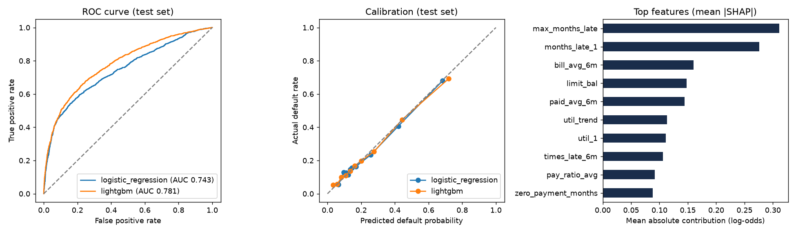

# Loan Risk Scorer

Predicts the chance that a credit-card client defaults next month, picks a lending cut-off that
maximises profit, and serves the model through an API with plain-English reasons for every decision.

Built on the public **UCI "Default of Credit Card Clients"** dataset: 30,000 clients in Taiwan,
6 months of account history each (April–September 2005), 22.1% of whom defaulted.



## Results (6,000 clients held out from training)

| Model | Cross-validated AUC (5 folds) | Test AUC | Gini | KS | Brier |
|---|---|---|---|---|---|
| Logistic regression (baseline) | 0.762 ± 0.009 | 0.743 | 0.487 | 0.386 | 0.140 |
| **LightGBM (monotonic)** | **0.785 ± 0.005** | **0.781** | **0.563** | **0.430** | **0.134** |

**Lending decision.** Assuming an approved payer earns 1 unit and an approved defaulter loses 5:

| Policy | Approved | Default rate among approved | Profit per applicant |
|---|---|---|---|
| Approve everyone | 100% | 22.1% | −0.33 |
| Simple rule: reject if 2+ months late now | 89.4% | 16.6% | +0.01 |
| **Model, cut-off 17%** | **57.6%** | **10.0%** | **+0.23** |

At the cut-off the model turns away 74% of eventual defaulters while turning away 33% of payers.
The riskiest 20% of clients contain 51% of all defaulters (see the gains table in `reports/sql_findings.md`).

**Risk bands** (actual default rate on the test set): A 7.4% · B 14.2% · C 25.4% · D 44.3% · E 68.1%.

**Fairness.** Sex and marital status are not model inputs. Checked afterwards on the test set:
AUC is 0.778 for men and 0.783 for women; approval rates are 56.1% and 58.6%, in line with their actual
default rates (23.4% and 21.3%).

## What the SQL analysis found

Run with DuckDB over the cleaned data (`sql/`, results in `reports/sql_findings.md`):

- Clients **2 months late** last month default at **69%**, against **13%** for clients paying on time.
- Default rate falls steadily with credit limit: **36%** under 50k, **21%** from 50k to 300k, **14%** above 300k.
- Clients over their limit default at 30%, but the 70–100% utilisation band holds more of all defaults (29%).
- The youngest (21–24) and oldest (60+) age bands are the riskiest, 5–6 points above average.

## How it works

1. **`riskscore/data.py`** downloads the data, renames columns and folds undocumented codes.
2. **`riskscore/features.py`** builds 17 features from the raw history: months late (latest, worst,
   count, current streak), utilisation (latest, average, trend), payment-to-bill ratios, and months with
   a bill but no payment. Training and the API call the same function, so features can't drift apart.
3. **`riskscore/train.py`**
   - 80/20 stratified split; the test set is used once at the end.
   - 5-fold CV for logistic regression and LightGBM.
   - **Monotonic constraints:** being later on payments can never lower the predicted risk.
   - The cut-off is chosen on out-of-fold training predictions, not on the test set.
   - Reason codes come from LightGBM's built-in SHAP values.
4. **`riskscore/sql_analysis.py`** runs the SQL files (GROUP BY, CASE bands, HAVING, CTEs, window
   functions such as `RANK`, `NTILE` and running `SUM OVER`).
5. **`api/app.py`** is a FastAPI service:
   - `POST /score` returns probability, band, decision and the top 3 reasons.
   - `POST /score/batch` scores up to 1,000 applicants per call.
   - `GET /metrics` and `GET /health`.
   - A one-page dashboard at `/`.
   - Inputs are checked with Pydantic, and bad requests get a 422.
6. **`riskscore/jobs.py` + `worker/worker.py`** add asynchronous batch scoring:
   - `POST /jobs` takes up to 100,000 applicants and returns a job id at once (HTTP 202).
   - The job is split into chunks of 1,000. Chunks are stored in **MongoDB**, and one message per chunk
     goes on a durable **RabbitMQ** queue, with publisher confirms and persistent messages.
   - Workers take one chunk at a time (`prefetch_count=1`) and score it in a single vectorised model call.
     A message is acknowledged only after its results are saved, so a crashed worker's chunk goes to
     another worker.
   - A failing chunk is retried up to 3 times, then sent to a dead-letter queue. A redelivered chunk is
     never counted twice.
   - `GET /jobs/{id}` shows progress and, at the end, approval rate, risk-band counts and throughput.
     `GET /jobs/{id}/results` pages through the scores.
   - More workers score one big job in parallel: `docker compose up --scale worker=4`.
7. **`tests/`** has 17 pytest tests:
   - feature edge cases (zero and negative bills, streaks)
   - API decisions and input validation
   - a check that a later payment never lowers risk
   - job splitting, completion and failure handling, idempotent redelivery, and a 503 when the queue is down

## Queue throughput

All 30,000 clients sent as one job (30 chunks), measured with `scripts/load_test.py` on one 12-core
laptop, 3 runs each:

| Workers | CPU threads per worker | Scoring time | Rows per second |
|---|---|---|---|
| 1 | all 12 | 4.3 s | ~6,900 |
| **4** | **3** | **3.1 s** | **~9,700** |
| 6 | 2 | 3.0–3.5 s | ~9,300 |
| 12 | 1 | 3.4–3.7 s | ~8,600 |

On one machine the gain is about 1.4x, because a single worker already uses every core. Workers on separate
machines add their full speed. `SCORER_THREADS` sets how many cores each worker uses.

## Run it

```bash
python -m venv .venv && .venv/Scripts/activate      # macOS/Linux: source .venv/bin/activate
pip install -r requirements.txt
python -m riskscore.data          # download + clean
python -m riskscore.train         # train, evaluate, save model and charts
python -m riskscore.sql_analysis  # SQL findings
pytest                            # 17 tests
uvicorn api.app:app --reload      # open http://127.0.0.1:8000
```

Full system with RabbitMQ, MongoDB and 4 workers (after training):

```bash
docker compose up --build -d --scale worker=4
python scripts/load_test.py --rows 30000    # queue all 30,000 clients as one job and time it
```

The RabbitMQ dashboard is at http://localhost:15672 (guest / guest).

Example request:

```bash
curl -X POST http://127.0.0.1:8000/score -H "Content-Type: application/json" -d '{
  "limit_bal": 50000, "age": 26, "education": 2,
  "pay_status": [2, 2, 2, 0, 0, 0],
  "bill_amounts": [49500, 48800, 47100, 45000, 43900, 42000],
  "paid_amounts": [0, 0, 1500, 2000, 1800, 1700]}'
```

## Limits

- The data is from one Taiwanese card issuer in 2005. The model shows the method; it is not a model for
  lending today.
- The 1 : 5 profit rule is an assumption. A real lender would use its own margins and loss-given-default.
- Age is a model input. Some lenders and regulators restrict this; dropping it is a one-line change in
  `features.py`.

Data: Yeh, I-C. (2009). Default of Credit Card Clients. UCI Machine Learning Repository,
https://doi.org/10.24432/C55S3H (CC BY 4.0).
